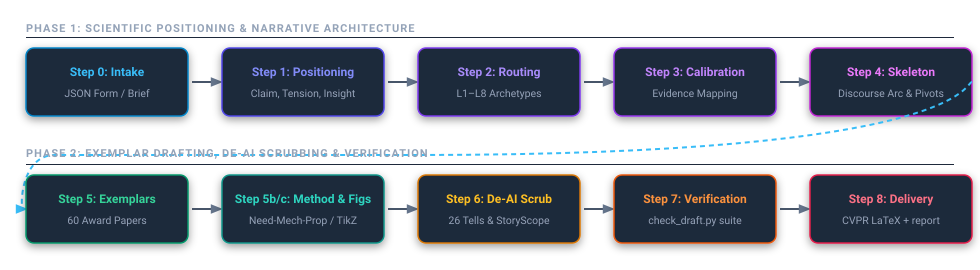

<div align="center">

# 🖋️ Write-Paper-Like-a-Human
### High-Impact Best-Paper Architecture & Rigorous Scientific De-AI Humanization

**Persuade reviewers by combining award-winning academic narrative structure with authentic human voice and discourse discipline**

[](CHANGELOG.md)
[](LICENSE)
[](PAPER_LIST.md)
[](references/storyscope-discourse.md)
[](references/humanizer-patterns.md)
[](.claude-plugin/plugin.json)
[](.cursor-plugin/plugin.json)

[🌐 English](README.md) · [🇻🇳 Tiếng Việt](README_vi.md) · [60 Award Paper Corpus](PAPER_LIST.md) · [Changelog](CHANGELOG.md) · [Notice & Citations](NOTICE.md)

</div>

---

## 🎯 Motivation & Core Philosophy

When researchers prompt large language models to draft scientific papers, the resulting manuscripts frequently face **immediate desk rejection or severe reviewer skepticism**.

### Why Surface "Humanizers" Fail
The foundational paper **StoryScope: Investigating idiosyncrasies in AI fiction** (Russell et al., COLM 2026, UMD & Google DeepMind, arXiv:2604.03136v6) revealed that:
> *"Surface-level lexical/syntactic signals account for less than 3% of discriminative power. Over 97% of detection signals stem from **Discourse-Level Narrative Architecture**."*

AI models (Claude, GPT, Gemini, DeepSeek, Kimi) consistently exhibit telltale discourse anomalies:
1. **Thematic Over-determination & Moralizing**: Preaching paper importance and sermonizing about broad impacts ("paving the way for the future of AI") rather than letting empirical deltas carry conviction.
2. **Structural Streamlining**: Creating a frictionless, single-track problem-solving narrative that conceals technical trade-offs, scope constraints, and the failure modes of naive alternatives.
3. **Lack of Operational Agency**: Attributing outcomes to passive system illusions ("the model understands the geometry") rather than exact mathematical operators, loss gradients, and architectural invariants.
4. **Metronomic Monotony**: Uniform sentence lengths (18–24 words), overused transition formulas (*However, Moreover, Furthermore*), forced triads, and ubiquitous em-dash splices (`—`).

### The Unified Synthesis
`Write-Paper-Like-a-Human` bridges three rigorous foundations into one coherent system:
- 🏛️ **Best-Paper Architecture**: Distilled from sentence-by-sentence analysis of **60 CVPR, ICCV, and NeurIPS award papers (2021–2025)**. Provides sharp motivation, 8 paper archetypes (L1–L8), strict claim-to-evidence calibration, and vector figure planning (Figure 1 typology, TikZ).
- 🧹 **26 Anti-AI Tell Patterns**: Derived from WikiProject AI Cleanup and `humanizer` (v4.0.0), eradicating *Not X but Y* staging, dramatic slogan closers, universal dashes, and AI vocabulary (`delve`, `pivotal`, `seamless`, `landscape`, `tapestry`, `bolstered`).
- 🔬 **StoryScope Discourse Discipline (COLM 2026)**: Restores authentic scientific agency, operational causal attribution, technical friction, and dynamic sentence burstiness ($\sigma_{\text{length}} \ge 9.5$).

---

---

## 🚀 What's New in v1.0.2 (Anti-Clustering & Voice Diversification)

Version `1.0.2` eliminates the "100 papers like one" template trap and equips authors with rapid deadline auditing tools:

### 1. Anti-Meta-Clustering (The 4 Rhetorical Stances)
Rigid templates produce a new kind of synthetic sameness. v1.0.2 introduces **Rhetorical Stance Diversification** (`references/diversity-and-voice.md`), allowing papers to adopt the structure that naturally fits the discovery:
- **The Empirical Conflict Stance (Data-First)**: Opens with an unexpected measurement or failure of standard models under real-world shifts.
- **The Theoretical Paradox Stance (Principle-First)**: Opens with formulation bloat and resolves it through analytical equivalence theorems.
- **The Systems Pragmatism Stance (Constraint-First)**: Opens with hardware bottlenecks (VRAM, latency cliffs) and establishes Pareto efficiency.
- **The Historical Linchpin Stance (Lineage-First)**: Traces the macro-evolution of the subfield across three distinct eras, isolating the missing linchpin.
- **3 Authorial Personas**: Calibrated voices for *The Theorist*, *The Naturalist*, and *The Systems Architect*.

### 2. Dual Operational Gears: Architect vs. Emergency Triage Mode
- **Architect Mode (Gear 1)**: The standard deep 8-step pipeline for building a manuscript from scratch.
- **Emergency Triage Mode (Gear 2)**: For panic situations with <24–48 hours until deadline:
  ```bash
  python scripts/check_draft.py --triage draft_intro.tex
  ```
  Runs an instant 3-minute diagnostic: flags fatal AI tells (`delve`, `pivotal`, `seamless`), audits sentence cadence/burstiness ($\sigma_{\text{length}}$), checks numerical groundings, and generates a 4-step rapid action plan.

### 3. Context-Aware Mathematical False-Positive Exemptions
Upgraded regex engines in `check_draft.py` to recognize legitimate technical terminology:
- Allows valid physical and mathematical uses of `landscape` (e.g., *loss landscape*, *optimization landscape*, *energy landscape*, *fitness landscape*).
- Allows theoretical theorem proofs to use *prove/proof* without false flagging.

### 4. Battle of Assumptions & Rebuttal Readiness
- **Related Work** (`references/related-work.md`): Dissects prior work by conflicting core assumptions rather than flat chronological summaries.
- **Rebuttal Defense** (`references/rebuttal.md`): Direct, evidence-first peer-review response protocols without groveling apologies or empty rhetoric.

---

## ⚡ The 8-Step Scientific Pipeline

Do not write ungrounded prose before Step 4.

<p align="center">
  
</p>

<table align="center" width="100%">
  <thead>
    <tr style="background:#1e293b; color:#94a3b8;">
      <th colspan="5" align="center"><b>PHASE 1: SCIENTIFIC POSITIONING &amp; NARRATIVE ARCHITECTURE</b></th>
    </tr>
  </thead>
  <tbody>
    <tr align="center">
      <td width="20%"><b>Step 0: Intake</b><br>JSON Form / Brief</td>
      <td width="20%"><b>Step 1: Positioning</b><br>Claim, Tension, Insight</td>
      <td width="20%"><b>Step 2: Routing</b><br>L1–L8 Archetypes</td>
      <td width="20%"><b>Step 3: Calibration</b><br>Evidence Mapping</td>
      <td width="20%"><b>Step 4: Skeleton</b><br>Discourse Arc &amp; Pivots</td>
    </tr>
    <tr style="background:#1e293b; color:#94a3b8;">
      <th colspan="5" align="center"><b>PHASE 2: EXEMPLAR DRAFTING, DE-AI SCRUBBING &amp; VERIFICATION</b></th>
    </tr>
    <tr align="center">
      <td width="20%"><b>Step 5: Exemplars</b><br>60 Award Papers</td>
      <td width="20%"><b>Step 5b/c: Method &amp; Figs</b><br>Need-Mech-Prop / TikZ</td>
      <td width="20%"><b>Step 6: De-AI Scrub</b><br>26 Tells &amp; StoryScope</td>
      <td width="20%"><b>Step 7: Verification</b><br>check_draft.py suite</td>
      <td width="20%"><b>Step 8: Delivery</b><br>CVPR LaTeX + report</td>
    </tr>
  </tbody>
</table>

### Step 0 — Research Intake & Briefing
- **Mode A: Structured Intake Form.** Complete the local offline HTML form `assets/intake_form.html` (exports `bestpaper-intake/v1` JSON), then run:
  ```bash
  python scripts/intake_to_brief.py intake.json --out brief.md --bib refs.bib
  ```
- **Mode B: Reverse-Engineering Existing Drafts / De-AI Scrubbing.** Reverse-engineer an existing draft into the intake schema, audit against the 26 Humanizer patterns, and output a structured change table: `[Original] → [Humanized Scientific] → [Pattern Applied & Technical Rationale]`.
- **Invariant**: Never fabricate numbers, baselines, or citations. Mark missing items as `[TODO: ...]` or `\TODO{}`.

### Step 1 — Scientific Positioning & Core Thesis
Formulate six strategic anchors (saved in `report.md`, not paper text):
1. **Core Claim**: `We show that [method] [achieves what] [under which setting], because [exact technical cause].`
2. **Tension Type**: Choose from `references/routing.md` (*tradeoff*, *capability-missing*, *obvious-fix-too-costly*, *unexplained-phenomenon*, *open-question*, *belief-overturned*).
3. **Core Insight**: The underlying physical, geometric, or mathematical observation stated as a direct fact (e.g., *"sampling rates bound reconstructable frequencies"*).
4. **Conceptual Handle**: A short name for the idea (e.g., *"integrated positional encoding"*, *"next-scale prediction"*).
5. **Closest Baseline & Checkable Difference**: Name the closest work and state the exact operational distinction (in loss, parametrization, or assumption).
6. **Headline Numbers**: The 1–2 key metrics carrying the central claim.

### Step 2 — Paper Routing
Match the research against the 8 paper archetypes in `references/routing.md`:
- **L1**: Method improvement (43% of award papers)
- **L2**: New capability / new task (e.g., DreamBooth, VGGT)
- **L3**: Dataset / benchmark
- **L4**: Measurement / large-scale empirical study
- **L5**: Mechanism analysis
- **L6**: Theoretical foundation (e.g., DPO)
- **L7**: Empirical / scaling law
- **L8**: Re-examination / constructive critique

### Step 3 — Claim Calibration & Evidence Mapping
Load `references/claim-calibration.md`.
- Map: **Claim $\to$ Method Component $\to$ Experiment Table/Figure $\to$ Ablation**.
- State claims at the strongest supported level: confident where backed by data, scoped where bounded.
- **Anti-Defensive Rule**: Zero defensive disclaimers (*"remains to be explored"*, *"does not establish"*, *"one limitation is"*) in Abstract or Introduction. Real limitations belong exclusively in the **Limitations** section.

### Step 4 — Discourse Architecture & Skeleton
Build a 5-paragraph Introduction skeleton (`references/introduction.md`, `references/storyscope-discourse.md`):
1. **Paragraph 1 (Context & Credit)**: Credit specific prior work; define what works well in standard settings.
2. **Paragraph 2 (Gap & Root Cause)**: Name the exact observable failure condition and its underlying mechanism. Rule out the naive fix with quantified costs (FLOPs/hours).
3. **Paragraph 3 (Insight & Formulation)**: State the problem observation; present the method as its natural consequence.
4. **Paragraph 4 (Mechanistic Contrast)**: Contrast mechanisms against the closest baseline.
5. **Paragraph 5 (Empirical Evidence & Scope)**: Present headline results with exact numbers and boundary conditions.
6. **Pivot Sentences**: Place short, punchy sentences (5–10 words) at transition points.

### Step 5 — Drafting with Exemplars
Retrieve matching moves from `references/exemplars/`:
```bash
python scripts/find_exemplars.py --para contrast --type L1
python scripts/find_exemplars.py intro.insight -n 3
```
- Emulate the structural flow and information ordering; never copy $\ge 6$ consecutive words (`check_draft.py` enforces this).
- Use active first-person plural (*"We formulate"*, *"We observe"*).

### Step 5b — Method & Experiments Execution
- **Method** (`references/method.md`): Describe each component through **Need $\to$ Mechanism $\to$ Property**.
- **Experiments** (`references/experiments.md`): Claim-first organization. Ablation tables mirror method claims one-to-one.

### Step 5c — Strategic Figure Planning & Vector Graphics
Load `references/figures.md`.
- **Figure 1**: Select by route archetype (`contrast-schematic`, `diagnosis`, `teaser-strip`). Placed full-width on Page 1 or 2.
- **Draw Mechanisms**: Generate vector TikZ schematics (`assets/figures/overview_tikz.tex`) and publication-grade matplotlib plots (`assets/figures/plot_style.py`, `bestpaper.mplstyle`).
- **Placeholder Discipline**: Do not fabricate results. Use framed placeholder blocks with caption plans (`\FigPlan{...}`).

### Step 6 — Full-Spectrum De-AI Scrubbing Pass
Audit text against all 26 Humanizer patterns (`references/humanizer-patterns.md`):
- Strip out *Not X but Y*, one-line slogan closers, and staged run-ups.
- **Hard No-Dash Rule**: Eradicate all em dashes (`—`) and spaced en dashes (` – `). Replace with periods, colons, or parentheses.
- Purge AI vocabulary: *delve, pivotal, seamless, landscape, tapestry, bolstered, testament, revolutionize, intricate*.
- Eliminate moralizing sermons (StoryScope).

### Step 7 — Automated Mechanical Verification
Run the verification test suite:
```bash
# Check prose for AI tells, banned phrases, and statistical bounds
python scripts/check_draft.py template/CVPR2027/sec/0_abstract.tex template/CVPR2027/sec/1_intro.tex

# Check LaTeX figure placements, captions, and vector formats
python scripts/check_figures.py template/CVPR2027/main.tex

# Measure style metrics against the 55 award-paper distribution
python scripts/style_metrics.py template/CVPR2027/sec/0_abstract.tex
```
- Resolve all `ERROR`s; justify any `WARN`.

### Step 8 — Final Delivery
Deliver:
1. Complete LaTeX project (`template/CVPR2027/`) compiling cleanly to PDF.
2. Companion **Author Strategic Report** (`report.md`) detailing the claim map, insight, handle, figure plan, and limitations notes.

---

## 🚫 The 8 Hard Rules

| # | Rule | Requirement & Solution |
|---|---|---|
| **1** | **Zero Fabrication** | Never invent numbers, baselines, or citations. Mark missing items with `\TODO{}`. |
| **2** | **No Dashes** | Strictly forbid em dashes (`—`) and spaced en dashes. Use periods, colons, or parentheses. |
| **3** | **No Intro Disclaimers** | Keep self-undermining disclaimers out of Abstract/Intro. Place in Limitations. |
| **4** | **No Trailing Participles** | Ban empty trailing participial clauses (*", making real-time rendering possible"*). State measured deltas. |
| **5** | **Mechanistic Attribution** | Attribute actions to mathematical operators and loss gradients, not anthropomorphic models. |
| **6** | **Sentence Burstiness** | Alternate short pivot sentences (5–10 words) with compound causal explanations (22–32 words). |
| **7** | **Citation Hygiene** | Cite only keys present in the user's bibliography. |
| **8** | **Anti-Preachiness (StoryScope)** | Never conclude with moralizing sermons about the future of humanity. Conclude on concrete technical capability. |

---

## 🛠️ Installation & Usage

### 1. Claude Code
Install directly as a plugin:
```bash
claude plugin marketplace add Vlet0/write-paper-like-a-human
claude plugin install write-paper-like-a-human@write-paper-like-a-human
```
Invoke in your session:
```text
/write-paper-like-a-human "Draft this paper from brief.md following CVPR Best Paper guidelines"
```

### 2. Cursor IDE
The repository includes `.cursor-plugin/plugin.json`. Open the workspace in Cursor or reference the skill prompt in your `.cursorrules`.

### 3. Codex & OpenAI CLI
Install via npm/npx:
```bash
npx skills add Vlet0/Write-Paper-Like-aHuman --global --agent codex
```

### 4. Direct CLI Usage
```bash
# Convert intake JSON to drafting brief
python scripts/intake_to_brief.py my_intake.json --out brief.md --bib refs.bib

# Query real award-paper exemplars
python scripts/find_exemplars.py --para insight --type L1
python scripts/find_exemplars.py intro.gap -n 3

# Audit draft for AI tells and statistical bounds
python scripts/check_draft.py draft_intro.tex

# Validate package integrity
python scripts/validate-package.py
```

---

---

## 📚 References & Upstream Projects

This framework synthesizes and builds upon the collective wisdom of foundational open-source projects, linguistic initiatives, and empirical deep learning research:

1. **Best-Paper-Writing-Skill**
   - **Repository**: [gulucaptain/Best-Paper-Writing-Skill](https://github.com/gulucaptain/Best-Paper-Writing-Skill)
   - **Authors**: gulucaptain, Master-cai ([Research-Paper-Writing-Skills](https://github.com/Master-cai/Research-Paper-Writing-Skills)), Peng Sida ([learning_research](https://github.com/pengsida/learning_research)).
   - **Contribution**: Sentence-by-sentence annotation and rhetorical distillation of 60 award-winning papers from CVPR, ICCV, and NeurIPS (2021–2025); the 8-type paper routing taxonomy, claim calibration methodology, and Figure 1 planning.
   - **License**: Creative Commons Attribution 4.0 International (CC BY 4.0) & MIT.

2. **Humanizer**
   - **Repository**: [blader/humanizer](https://github.com/blader/humanizer)
   - **Author**: Siqi Chen ([@blader](https://github.com/blader)), sponsored by [cfo.ai](https://cfo.ai).
   - **Foundation**: Built upon Wikipedia's community-driven [WikiProject AI Cleanup: Signs of AI writing](https://en.wikipedia.org/wiki/Wikipedia:Signs_of_AI_writing).
   - **Contribution**: The 26 anti-AI tell patterns, factual preservation invariants, sentence burstiness engineering, and strict prohibition of universal connectors and em-dashes (`—`).
   - **License**: MIT License.

3. **StoryScope (COLM 2026)**
   - **Paper**: *"StoryScope: Investigating idiosyncrasies in AI fiction"*, Conference on Language Modeling (COLM 2026), arXiv:2604.03136v6.
   - **Authors**: Jenna Russell, Rishanth Rajendhran, Chau Minh Pham, Mohit Iyyer, John Wieting (University of Maryland, College Park & Google DeepMind).
   - **Contribution**: Empirical demonstration that >97% of AI detection signal resides in discourse-level narrative architecture; formulation of anti-thematic over-determination, technical friction, and operational agency.

---

## 🙏 Acknowledgments & Gratitude

We express our deepest gratitude to:
- **gulucaptain**, **Master-cai**, and **Peng Sida** for their monumental effort in dissecting 60 top-tier award-winning papers and open-sourcing the structural blueprints that empower researchers to argue with clarity and rigor.
- **Siqi Chen (blader)** and the **Wikipedia WikiProject AI Cleanup** volunteers for codifying the subtle linguistic tells of generative language models into actionable editing rules, fighting the tide of synthetic slop.
- **Jenna Russell, Rishanth Rajendhran, Chau Minh Pham, Mohit Iyyer, and John Wieting** (UMD & Google DeepMind) for their pioneering research into narrative idiosyncrasies and discourse-level detection in AI writing.
- **The global machine learning and scientific community** (CVPR, ICCV, NeurIPS, ICML, COLM) for maintaining the highest standards of peer review, intellectual honesty, and reproducible scholarship.

---

## 📜 License & Citation

This project is released under a clear dual-licensing model:
- 💻 **Software, Scripts, and Templates (`scripts/`, `template/`)**: Licensed under the **[MIT License](LICENSE)**.
- 📖 **Documentation, Prompts, and Reference Guides (`references/`, `SKILL.md`)**: Licensed under the **[Creative Commons Attribution 4.0 International (CC BY 4.0)](LICENSE)**.
- 💡 **Acknowledgments**: See [`NOTICE.md`](NOTICE.md) for detailed attribution to `Best-Paper-Writing-Skill`, `humanizer`, and `StoryScope` (COLM 2026).

### BibTeX Citation
```bibtex
@software{write_paper_like_a_human2026,
  author = {Vlet0 and Contributors},
  title = {{Write-Paper-Like-a-Human}: High-Impact Best-Paper Architecture and Rigorous Scientific De-AI Humanization},
  year = {2026},
  url = {https://github.com/Vlet0/Write-Paper-Like-aHuman},
  license = {MIT and CC-BY-4.0}
}

@software{best_paper_writing_skill2025,
  author = {gulucaptain and Master-cai and Peng, Sida},
  title = {{Best-Paper-Writing-Skill}: Writing patterns distilled from 60 award papers},
  year = {2025},
  url = {https://github.com/gulucaptain/Best-Paper-Writing-Skill}
}

@software{humanizer2025,
  author = {Chen, Siqi},
  title = {Humanizer: Rewrite AI-sounding text so it reads like the writer},
  year = {2025},
  url = {https://github.com/blader/humanizer}
}

@inproceedings{russell2026storyscope,
  title = {{StoryScope}: Investigating idiosyncrasies in {AI} fiction},
  author = {Russell, Jenna and Rajendhran, Rishanth and Pham, Chau Minh and Iyyer, Mohit and Wieting, John},
  booktitle = {Conference on Language Modeling (COLM)},
  year = {2026},
  url = {https://arxiv.org/abs/2604.03136}
}
```

---

<div align="center">
<b>Dedicated to scientific integrity, rigorous clarity, and authentic human scholarship.</b><br>
If you find this project valuable, please star ⭐️ our repository on <a href="https://github.com/Vlet0/Write-Paper-Like-aHuman.git">GitHub</a>!
</div>
