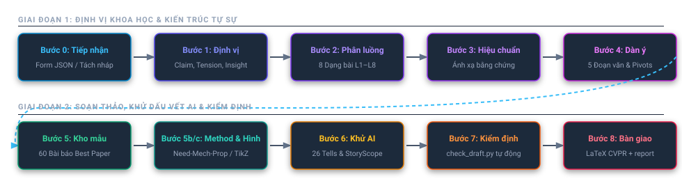

<div align="center">

# 🖋️ Write-Paper-Like-a-Human
### Phương Pháp Viết Bài Báo Khoa Học Đỉnh Cao & Khử Dấu Vết AI Toàn Diện

**Kiến trúc bài báo khoa học đạt giải Best Paper kết hợp kỷ luật ngôn ngữ tự nhiên của con người**

[](CHANGELOG.md)
[](LICENSE)
[](PAPER_LIST.md)
[](references/storyscope-discourse.md)
[](references/humanizer-patterns.md)
[](.claude-plugin/plugin.json)
[](.cursor-plugin/plugin.json)

[🌐 English](README.md) · [🇻🇳 Tiếng Việt](README_vi.md) · [Danh sách 60 bài báo mẫu](PAPER_LIST.md) · [Nhật ký cập nhật](CHANGELOG.md) · [Ghi công & Bản quyền](NOTICE.md)

</div>

---

## 🎯 Giới Thiệu & Triết Lý Cốt Lõi

Khi các nhà nghiên cứu sử dụng Large Language Models (LLM) để viết bài báo khoa học, hầu hết các bản thảo đều **bị reviewer từ chối hoặc bị phát hiện bởi hệ thống sàng lọc AI**.

### Tại sao các công cụ "Humanizer" thông thường đều thất bại?
Nghiên cứu mang tính đột phá **StoryScope: Investigating idiosyncrasies in AI fiction** (Russell et al., COLM 2026, Đại học Maryland & Google DeepMind, arXiv:2604.03136v6) đã chứng minh:
> *"Các tín hiệu từ vựng bề mặt (synonym swapping, perplexity) chỉ chiếm chưa đầy 3% năng lực phân biệt văn bản AI. 97% dấu hiệu nhận diện nằm ở **Cấu trúc tự sự ở tầng diễn ngôn (Discourse-Level Narrative Architecture)**."*

Các mô hình AI (Claude, GPT, Gemini, DeepSeek, Kimi) đều mắc phải các "tử huyệt" diễn ngôn:
1. **Thematic Over-determination (Thuyết giảng & Thổi phồng tầm quan trọng)**: AI luôn có xu hướng kết luận bài viết bằng những câu đao to búa lớn về "mở ra kỷ nguyên mới cho nhân loại", "đóng vai trò then chốt", thay vì để các số liệu thực nghiệm tự lên tiếng.
2. **Structural Streamlining (Sự trơn tru giả tạo)**: AI luôn dựng lên kịch bản giải quyết vấn đề tuyến tính, một chiều, không tì vết ("Vấn đề A khó khăn $\to$ Chúng tôi đề xuất mô hình B $\to$ Mô hình B vượt trội toàn diện trên mọi benchmark"). Nó che giấu các đánh đổi kỹ thuật (trade-offs), giới hạn phạm vi, và không giải thích tại sao giải pháp ngây thơ (naive baseline) thất bại.
3. **Lack of Operational Agency (Thiếu vắng chủ thể vận hành cụ thể)**: AI dùng câu bị động hoặc gán nhận thức cho mô hình ("mô hình thấu hiểu không gian"), thay vì nêu rõ toán tử toán học, gradient hàm mất mát hay ràng buộc hình học cụ thể nào tạo ra kết quả.
4. **Metronomic Monotony (Nhịp điệu đều đều như máy đập nhịp)**: Câu văn có độ dài đều nhau (18–24 từ), lạm dụng từ nối công thức (*However, Moreover, Furthermore, To this end*), ép bộ ba song hành (forced triads), và tràn ngập dấu gạch ngang (`—`).

### Sự Hợp Nhất Thống Nhất: Write-Paper-Like-a-Human
Dự án này là sự kết hợp sâu sắc và nghiêm ngặt giữa ba trụ cột:
- 🏛️ **Kiến trúc bài báo đỉnh cao (Best-Paper Architecture)**: Đúc kết từ phân tích từng câu chữ của **60 bài báo đoạt giải Best Paper tại CVPR, ICCV, NeurIPS (2021–2025)**. Định hình cách xây dựng động lực nghiên cứu sắc bén, hiệu chuẩn luận điểm (Claim Calibration), ánh xạ bằng chứng (Evidence Map), phân loại 8 dạng bài báo (L1–L8), và quy hoạch hình ảnh (Figure 1 typology, TikZ vector).
- 🧹 **Bộ 26 quy tắc khử dấu vết AI (The 26 Anti-AI Tell Patterns)**: Kế thừa từ bộ quy tắc WikiProject AI Cleanup của Wikipedia và dự án `humanizer` (v4.0.0), loại bỏ triệt để các cấu trúc AI đặc trưng: *Not X but Y*, slogan kết bài, triệt tiêu gạch ngang (`—`), gọt giũa từ ngữ sáo rỗng (`delve`, `pivotal`, `seamless`, `landscape`, `tapestry`).
- 🔬 **Kỷ luật diễn ngôn StoryScope (COLM 2026)**: Tái lập tính chân thực khoa học, chủ thể vận hành cơ học rõ ràng, tôn trọng sự va chạm kỹ thuật thực tế, và tạo nhịp điệu câu văn đa dạng (burstiness).

---

---

## 🚀 Điểm Mới Nổi Bật Ở Bản V1.0.2 (Chống Rập Khuôn & Đa Dạng Giọng Văn)

Phiên bản `v1.0.2` phá bỏ hoàn toàn cái bẫy "100 bài như 1" (chống rập khuôn mẫu) và bổ sung chế độ cấp cứu khẩn cấp cho deadline:

### 1. Phá Vỡ Rập Khuôn (4 Lập Trường Tu Từ Đa Dạng - Anti-Meta-Clustering)
Việc ép mọi bài báo vào cùng một bộ khung dẫn đến hiện tượng bài nào cũng giống bài nào. Bản v1.0.2 giới thiệu **4 Lập trường Tu từ (4 Rhetorical Stances)** và **3 Nhân dạng Tác giả (3 Authorial Personas)** trong `references/diversity-and-voice.md`:
- **The Empirical Conflict Stance (Dữ liệu thực nghiệm đi trước)**: Khởi đầu bằng một hiện tượng đo đạc bất thường hoặc sự sụp đổ của giả định cũ trước dữ liệu thực tế. Phù hợp cho bài phát hiện lỗi, đo đạc, benchmark mới.
- **The Theoretical Paradox Stance (Nguyên lý lý thuyết đi trước)**: Khởi đầu bằng sự phức tạp của công thức cũ và giải quyết bằng định lý tương đương giải tích (*analytical equivalence*). Phù hợp cho bài toán tối ưu, reparameterization (như DPO).
- **The Systems Pragmatism Stance (Ràng buộc hệ thống & phần cứng)**: Khởi đầu bằng nút thắt cổ chai phần cứng (tràn VRAM, trễ suy luận) và chứng minh sự vượt trội trên đường cong Pareto hiệu năng/tốc độ. Phù hợp cho mô hình thời gian thực, nén mô hình.
- **The Historical Linchpin Stance (Tiến trình lịch sử & Mắt xích còn thiếu)**: Khái quát 3 giai đoạn tiến hóa của phân ngành và chỉ ra đúng mắt xích còn khuyết để thống nhất các phương pháp. Phù hợp cho mô hình nền tảng đa nhiệm.
- **3 Nhân dạng tác giả**: Giọng văn chuyên biệt cho *Nhà lý thuyết (The Theorist)*, *Nhà quan sát thực nghiệm (The Naturalist)*, và *Kiến trúc sư hệ thống (The Systems Architect)*.

### 2. Hai Chế Độ Vận Hành: Kiến Trúc Sư vs. Cấp Cứu Deadline (`--triage`)
- **Chế độ Kiến trúc sư (Gear 1)**: Quy trình chuẩn 8 bước sâu sắc để xây dựng bài báo từ đầu.
- **Chế độ Cấp cứu khẩn cấp (Gear 2)**: Khi chỉ còn <24–48 giờ trước giờ nộp bài (*deadline panic*):
  ```bash
  python scripts/check_draft.py --triage draft_intro.tex
  ```
  Quét nhanh trong 3 phút: thanh trừng các tử huyệt AI (`delve`, `pivotal`, `seamless`, gạch ngang `—`), đo độ đa dạng nhịp điệu câu ($\sigma_{\text{length}}$), kiểm tra số liệu định lượng, và xuất kế hoạch sửa nhanh 4 bước.

### 3. Miễn Trừ Dương Tính Giả Cho Thuật Ngữ Toán Học & Khoa Học
Nâng cấp bộ nhận diện regex trong `check_draft.py` để phân biệt ngữ cảnh:
- Cho phép sử dụng từ `landscape` trong các khái niệm khoa học chuẩn xác (*loss landscape*, *optimization landscape*, *energy landscape*, *fitness landscape*).
- Cho phép dùng từ *prove/proof* trong chứng minh định lý toán học (*Mathematical Theorems*) mà không bị phạt nhầm.

### 4. Đấu Tranh Giả Định Trong Related Work & Kịch Bản Phản Biện (Rebuttal)
- **Related Work** (`references/related-work.md`): Cấu trúc phần nghiên cứu liên quan thành một "Cuộc chiến của các giả định kỹ thuật" (*Battle of Assumptions*) thay vì liệt kê theo thứ tự thời gian buồn ngủ.
- **Kịch bản Rebuttal** (`references/rebuttal.md`): Giao thức phản biện reviewer sắc bén, đi thẳng vào câu trả lời và số liệu thực nghiệm ngay từ dòng đầu tiên, không nịnh bợ hay xin xỏ rỗng tuếch.

---

## ⚡ Quy Trình Khoa Học 8 Bước (The 8-Step Pipeline)

Tuyệt đối không viết văn xuôi khi chưa hoàn thành Bước 3.

<p align="center">
  
</p>

<table align="center" width="100%">
  <thead>
    <tr style="background:#1e293b; color:#94a3b8;">
      <th colspan="5" align="center"><b>GIAI ĐOẠN 1: ĐỊNH VỊ KHOA HỌC &amp; KIẾN TRÚC TỰ SỰ</b></th>
    </tr>
  </thead>
  <tbody>
    <tr align="center">
      <td width="20%"><b>Bước 0: Tiếp nhận</b><br>Form JSON / Tách nháp</td>
      <td width="20%"><b>Bước 1: Định vị</b><br>Claim, Tension, Insight</td>
      <td width="20%"><b>Bước 2: Phân luồng</b><br>8 Dạng bài L1–L8</td>
      <td width="20%"><b>Bước 3: Hiệu chuẩn</b><br>Ánh xạ bằng chứng</td>
      <td width="20%"><b>Bước 4: Dàn ý</b><br>5 Đoạn văn &amp; Pivots</td>
    </tr>
    <tr style="background:#1e293b; color:#94a3b8;">
      <th colspan="5" align="center"><b>GIAI ĐOẠN 2: SOẠN THẢO, KHỬ DẤU VẾT AI &amp; KIỂM ĐỊNH</b></th>
    </tr>
    <tr align="center">
      <td width="20%"><b>Bước 5: Kho mẫu</b><br>60 Bài báo Best Paper</td>
      <td width="20%"><b>Bước 5b/c: Method &amp; Hình</b><br>Need-Mech-Prop / TikZ</td>
      <td width="20%"><b>Bước 6: Khử AI</b><br>26 Tells &amp; StoryScope</td>
      <td width="20%"><b>Bước 7: Kiểm định</b><br>check_draft.py tự động</td>
      <td width="20%"><b>Bước 8: Bàn giao</b><br>LaTeX CVPR + report</td>
    </tr>
  </tbody>
</table>

### Bước 0 — Tiếp Nhận Nghiên Cứu (Intake)
- **Chế độ A: Điền Form có cấu trúc.** Sử dụng form tương tác cục bộ `assets/intake_form.html` (xuất JSON chuẩn `bestpaper-intake/v1`), chuyển đổi thành brief bằng:
  ```bash
  python scripts/intake_to_brief.py intake.json --out brief.md --bib refs.bib
  ```
- **Chế độ B: Khử AI & Tái cấu trúc bản nháp có sẵn.** Phân rã văn bản người dùng cung cấp vào các trường dữ liệu nghiên cứu, lập bảng đối chiếu thay đổi `[Câu gốc] → [Câu đã viết lại chuẩn người] → [Quy tắc áp dụng]`.
- **Nguyên tắc bất biến**: Tuyệt đối không bịa đặt số liệu, tên baseline, tập dữ liệu hay citation. Phần nào thiếu phải đánh dấu rõ `[TODO: ...]` hoặc `\TODO{}`.

### Bước 1 — Định Vị Khoa Học & Luận Điểm Cốt Lõi
Xác định 6 yếu tố nền tảng (ghi vào `report.md`, không đưa nguyên văn vào bài báo):
1. **Luận điểm cốt lõi (Claim)**: `Chúng tôi chứng minh rằng [phương pháp] [đạt được gì] [trong điều kiện nào], bởi vì [nguyên nhân cơ học chính xác].`
2. **Loại căng thẳng (Tension Type)**: Đánh đổi (tradeoff), thiếu hụt năng lực (capability-missing), giải pháp hiển nhiên quá tốn kém (obvious-fix-too-costly), hiện tượng chưa giải thích được, câu hỏi mở, hoặc lật đổ quan niệm cũ.
3. **Điểm sáng vấn đề (Core Insight)**: Quan sát bản chất vật lý/toán học mà phương pháp bắt nguồn. Trình bày như một định đề khoa học hiển nhiên, không dùng khẩu hiệu "Ý tưởng then chốt của chúng tôi là...".
4. **Tên gọi ý niệm (Handle)**: Cụm từ ngắn gọn đặt tên cho ý tưởng (ví dụ: *"integrated positional encoding"*, *"next-brick prediction"*).
5. **Baseline gần nhất & Khác biệt có thể kiểm chứng**: Nêu đích danh 1–2 phương pháp mạnh nhất và chỉ rõ sự khác biệt ở cấp độ cơ chế (hàm mất mát, biến số, giả định).
6. **Số liệu tiêu đề (Headline Numbers)**: 1–2 con số then chốt gánh vác toàn bộ luận điểm.

### Bước 2 — Phân Luồng Bài Báo (Paper Routing)
Tra cứu `references/routing.md`. Xác định đúng 1 trong 8 dạng bài:
- **L1**: Cải tiến phương pháp (Method improvement - chiếm 43% best papers)
- **L2**: Khả năng mới / Bài toán mới (New capability - ví dụ DreamBooth, VGGT)
- **L3**: Tập dữ liệu / Benchmark mới (Dataset)
- **L4**: Phép đo / Đánh giá thực nghiệm quy mô lớn (Measurement)
- **L5**: Phân tích cơ chế (Mechanism analysis)
- **L6**: Lý thuyết toán học (Theory - ví dụ DPO)
- **L7**: Quy luật thực nghiệm (Empirical law / Scaling laws)
- **L8**: Tái kiểm định / Hoài nghi tích cực (Re-examination)

### Bước 3 — Hiệu Chuẩn Luận Điểm & Ánh Xạ Bằng Chứng (Claim Calibration)
Tra cứu `references/claim-calibration.md`.
- Thiết lập bản đồ: **Luận điểm $\to$ Tiểu mục Phương pháp $\to$ Bảng/Hình Thực nghiệm $\to$ Phân tích Ablation**.
- Mọi phát biểu trong Abstract và Introduction phải có bảng số liệu bảo chứng tương ứng.
- **Quy tắc phi phòng thủ (Anti-Defensive Rule)**: Không đưa các câu rào đón, tự bào chữa, tự nhận khuyết điểm (*"chưa kiểm chứng trên diện rộng"*, *"vẫn còn hạn chế"*) vào Abstract hay Introduction. Những nội dung này phải nằm đúng vị trí tại mục **Limitations**.

### Bước 4 — Kiến Trúc Tự Sự & Dàn Ý Diễn Ngôn (Discourse Skeleton)
Tra cứu `references/introduction.md`, `references/abstract.md` và `references/storyscope-discourse.md`.
Thiết kế dàn ý Introduction chuẩn 5 đoạn:
1. **Đoạn 1 (Hook & Khen ngợi tiền nhân)**: Cụ thể hóa thành công của các phương pháp đi trước; xác nhận những gì đang vận hành tốt.
2. **Đoạn 2 (Khoảng trống & Nguyên nhân kỹ thuật)**: Nêu chính xác điều kiện thất bại thực tế và giải thích nguyên nhân cốt lõi. Bác bỏ giải pháp ngây thơ bằng con số chi phí (FLOPs/thời gian) để chặn câu hỏi "Sao không làm cách đơn giản?".
3. **Đoạn 3 (Insight & Đề xuất phương pháp)**: Phát biểu quan sát khoa học; giới thiệu phương pháp như hệ quả tất yếu của quan sát đó.
4. **Đoạn 4 (So sánh cơ chế với công trình gần nhất)**: Đối chiếu ở cấp độ cấu trúc thuật toán thay vì chỉ so điểm benchmark.
5. **Đoạn 5 (Bằng chứng định lượng & Phạm vi)**: Đưa ra 1–2 con số đắt giá nhất trên benchmark chuẩn kèm phạm vi áp dụng.
6. **Câu bản lề (Pivot Sentences)**: Đặt các câu ngắn (5–10 từ) tại điểm giao thoa giữa các đoạn để tạo điểm nhấn trí tuệ.

### Bước 5 — Soạn Thảo Cùng Kho Mẫu (Exemplars Bank)
Tra cứu `references/exemplars/` để tìm đoạn văn mẫu tương ứng với hàm mục tiêu:
```bash
python scripts/find_exemplars.py --para contrast --type L1
python scripts/find_exemplars.py intro.insight -n 3
```
- Học cấu trúc sắp xếp thông tin và nhịp điệu của các bài báo xuất sắc; tuyệt đối không sao chép chuỗi từ $\ge 6$ từ (`check_draft.py` sẽ báo lỗi ERROR nếu vi phạm).
- Sử dụng ngôi thứ nhất số nhiều chủ động ("Chúng tôi xây dựng", "Chúng tôi quan sát").

### Bước 5b — Triển Khai Method & Experiments
- **Method** (`references/method.md`): Mỗi thành phần được diễn giải theo chuỗi **Nhu cầu (Need) $\to$ Cơ chế (Mechanism) $\to$ Tính chất (Property)**.
- **Experiments** (`references/experiments.md`): Trình bày theo phong cách Claim-first (Tiêu đề tiểu mục và chú thích bảng nêu ngay phát hiện thực nghiệm). Bảng ablation phải đối xứng 1-1 với các tuyên bố của phương pháp.

### Bước 5c — Quy Hoạch & Thiết Kế Hình Ảnh (Figures)
Tra cứu `references/figures.md`.
- **Figure 1**: Chọn mẫu phù hợp với route (`contrast-schematic` cho bài toán chi phí/insight, `diagnosis` cho bài toán lỗi hình ảnh, `teaser-strip` cho năng lực mới). Đặt toàn chiều rộng tại Trang 1 hoặc Trang 2.
- **Vẽ cơ chế thực**: Tạo sơ đồ vector TikZ sắc nét (`assets/figures/overview_tikz.tex`). Vẽ đồ thị bằng style chuẩn xuất bản (`assets/figures/plot_style.py` và `bestpaper.mplstyle`).
- **Kỷ luật giữ chỗ (Placeholder Discipline)**: Những phần đòi hỏi kết quả thực tế phải giữ nguyên khung trống kèm chú thích kế hoạch `\FigPlan{...}`; tuyệt đối không vẽ biểu đồ giả.

### Bước 6 — Quét Khử Dấu Vết AI Toàn Diện (The 26 Patterns Scrub)
Rà soát văn bản theo bảng 26 mẫu dấu hiệu AI (`references/humanizer-patterns.md`):
- Gỡ bỏ cấu trúc *Not X but Y*, slogan kịch tính một câu, triết lý sáo rỗng.
- **Luật Cấm Gạch Ngang (Hard No-Dash Rule)**: Thay thế toàn bộ dấu em-dash (`—`) và en-dash cách khoảng (` – `) bằng dấu chấm tách câu, dấu hai chấm hoặc mở ngoặc đơn.
- Tẩy sạch từ ngữ AI đặc trưng: *delve, pivotal, seamless, landscape, tapestry, bolstered, testament, revolutionize, intricate*.
- Triệt tiêu thói quen thuyết giảng moralizing của AI (StoryScope).

### Bước 7 — Kiểm Định Cơ Học Tự Động (Verification)
Chạy bộ script kiểm tra nghiêm ngặt:
```bash
# Kiểm tra bản thảo văn bản (Abstract / Intro / Body)
python scripts/check_draft.py template/CVPR2027/sec/0_abstract.tex template/CVPR2027/sec/1_intro.tex

# Kiểm tra quy cách hình ảnh và bảng biểu trong LaTeX
python scripts/check_figures.py template/CVPR2027/main.tex

# Đo lường các chỉ số phong cách so với phân vị 55 bài báo xuất sắc
python scripts/style_metrics.py template/CVPR2027/sec/0_abstract.tex
```
- Khắc phục 100% lỗi `ERROR`. Xem xét và giải trình các cảnh báo `WARN`.

### Bước 8 — Bàn Giao Ấn Phẩm
Xuất dự án hoàn chỉnh:
1. Thư mục mã nguồn LaTeX chuẩn hội nghị (`template/CVPR2027/`) biên dịch ra PDF hoàn hảo.
2. Tài liệu chiến lược `report.md` dành riêng cho tác giả (luận điểm, insight, handle, bảng thay đổi, kế hoạch hình ảnh, và ghi chú cho phần Limitations).

---

## 🚫 8 Nguyên Tắc Bất Biến (Hard Rules)

| # | Nguyên Tắc | Diễn Giải & Khắc Phục |
|---|---|---|
| **1** | **Không Bịa Đặt Dữ Liệu** | Tuyệt đối không sinh số liệu, baseline, benchmark hoặc citation ảo. Thiếu thì dùng `\TODO{}`. |
| **2** | **Cấm Dấu Gạch Ngang (No Dashes)** | Cấm tiệt em dash (`—`) và en dash cách khoảng trong văn xuôi. Dùng dấu chấm tách câu, dấu hai chấm hoặc ngoặc đơn. |
| **3** | **Không Disclaimer Ở Mở Đầu** | Cấm các câu hạ thấp kết quả hay nhận lỗi sớm trong Abstract/Intro. Chuyển toàn bộ vào mục Limitations. |
| **4** | **Không Vĩ Ngữ Phân Từ Thổi Phồng** | Cấm kết câu bằng cụm phân từ sáo rỗng (*", making real-time rendering possible"*). Nêu số đo delta cụ thể. |
| **5** | **Gán Chủ Thể Vận Hành Cơ Học** | Kết quả sinh ra từ toán tử, gradient hoặc hình học; mô hình không có "suy nghĩ" hay "cảm nhận". |
| **6** | **Tạo Nhịp Điệu Đột Phá (Burstiness)** | Đan xen câu ngắn bản lề (5–10 từ) với câu giải thích cơ chế phức hợp (22–32 từ). Chống nhịp đều đều. |
| **7** | **Bảo Toàn 100% Khóa Trích Dẫn** | Chỉ cite các key có sẵn trong file `.bib` của người dùng. |
| **8** | **Không Thuyết Giảng Đạo Lý (StoryScope)** | Không kết bài bằng văn mẫu "hướng tới AI an toàn và đạo đức cho nhân loại". Kết bằng năng lực kỹ thuật thực tế. |

---

## 📋 Tóm Tắt 26 Mẫu Dấu Vết AI (Anti-AI Tell Patterns)

Chi tiết đầy đủ và ví dụ Before/After xem tại [references/humanizer-patterns.md](references/humanizer-patterns.md).

- **Nhóm A: Dàn Dựng Thay Vì Trình Bày (§1–§5)**
  * `§1`: *Not X but Y* (Không chỉ A mà còn là B $\to$ Đi thẳng vào vấn đề).
  * `§2`: Slogan kết bài một câu & Câu cụt kịch tính (*"Đó là thắng lợi thực sự."* $\to$ Xóa bỏ).
  * `§3`: Châm ngôn nghe có vẻ sâu sắc (*"Bản chất của thị giác là vũ điệu..."* $\to$ Nêu định nghĩa toán học).
  * `§4`: Màn dạo đầu dàn dựng (*"Để hiểu điều này, hãy xem..."* $\to$ Bỏ màn dạo đầu).
  * `§5`: Tranh cãi với người vô hình (*"Chúng tôi không nói transformer lỗi thời..."* $\to$ Xóa bỏ phòng thủ).
- **Nhóm B: Nhịp Điệu Theo Công Thức (§6–§11)**
  * `§6`: Bộ ba song hành ép buộc (Forced triads: *"nhanh, chính xác, tổng quát"* $\to$ Nêu con số cụ thể).
  * `§7`: Mở đầu câu lặp lại (3 câu liên tiếp bắt đầu bằng *"Chúng tôi..."* $\to$ Đảo chủ ngữ sang cơ chế/dữ liệu).
  * `§8`: Lạm dụng gạch ngang (`—`) làm chốt nối đa năng $\to$ **Cấm tuyệt đối**.
  * `§9`: Chồng chất từ hạn định giảm trừ (*"có thể tiềm tàng cho thấy"* $\to$ *"chỉ ra rằng"*).
  * `§10`: Lạm dụng dấu nối từ ghép sau danh từ.
  * `§11`: Câu bị động giấu chủ thể $\to$ Chuyển sang chủ động.
- **Nhóm C: Thổi Phồng & Uy Quyền Vay Mượn (§12–§18)**
  * `§12`: Từ vựng AI kinh điển (`delve`, `pivotal`, `seamless`, `landscape`, `tapestry`, `bolstered`, `testament`).
  * `§13`: Thổi phồng ý nghĩa (*"minh chứng hùng hồn", "bước ngoặt lịch sử"* $\to$ Xóa tự khen, đưa số liệu delta).
  * `§14`: Mối liên hệ kỹ thuật mập mờ $\to$ Nêu rõ phương trình hoặc kênh truyền dữ liệu.
  * `§15`: Đuôi phân từ *-ing* hời hợt (*", qua đó khẳng định tính ưu việt"* $\to$ Cắt bỏ).
  * `§16`: Ngôn từ bán hàng PR (*"đột phá ngoạn mục, bộ kết quả phong phú tuyệt vời"* $\to$ Ngôn ngữ khoa học trung tính).
  * `§17`: Uy quyền vay mượn mơ hồ (*"các chuyên gia đều đồng thuận rằng..."* $\to$ Trích dẫn bài báo cụ thể).
  * `§18`: Tránh dùng động từ to-be (*"đóng vai trò như một bộ điều chuẩn"* $\to$ *"điều chuẩn"*).
- **Nhóm D: Định Dạng Thừa Thãi (§19–§21)**
  * `§19`: Bôi đậm tùy tiện giữa câu như caffein thị giác $\to$ Chuyển về chữ thường.
  * `§20`: Tiêu đề gắn emoji hoặc giật tít tiếp thị $\to$ Tiêu đề học thuật chuẩn mực.
  * `§21`: Dấu ngoặc kép cong trong code hoặc trích dẫn LaTeX sai chuẩn.
- **Nhóm E: Tàn Dư Chatbot & Dấu Vết Quy Trình (§22–§25)**
  * `§22`: Tàn dư chatbot (*"Hy vọng phản hồi này giúp ích", "Dưới đây là phương pháp"*).
  * `§23`: Tuyên bố miễn trừ giới hạn kiến thức (*"Tính đến thời điểm hiện tại..."*).
  * `§24`: Lặp lại tiêu đề ngay câu đầu tiên của mục.
  * `§25`: Viết về văn bản thay vì chủ đề khoa học (*"Dữ liệu do tác giả cung cấp trong form..."*).
- **Nhóm F: Viết Cho Sai Độc Giả (§26)**
  * `§26`: Giảng lại kiến thức cơ bản của sách giáo khoa cho reviewer đầu ngành.

---

## 🛠️ Cài Đặt & Sử Dụng

### 1. Claude Code
Cài đặt plugin trực tiếp từ GitHub:
```bash
claude plugin marketplace add Vlet0/write-paper-Like-aHuman
claude plugin install write-paper-like-a-human@write-paper-like-a-human
```
Sử dụng trong phiên làm việc:
```text
/write-paper-like-a-human "Soạn thảo bài báo từ brief.md theo phong cách CVPR Best Paper"
```

### 2. Cursor IDE
Thêm vào cấu hình Cursor Rules hoặc Skills. Repository đã tích hợp sẵn `.cursor-plugin/plugin.json`. Bạn chỉ cần clone repo vào workspace hoặc mở thư mục này trong Cursor.

### 3. Codex & OpenAI CLI
Sử dụng agent đã cấu hình sẵn trong `agents/openai.yaml`:
```bash
npx skills add Vlet0/Write-Paper-Like-aHuman --global --agent codex
```

### 4. Sử Dụng Trực Tiếp Qua CLI
Chạy kiểm tra và khai thác công cụ trực tiếp bằng Python 3.10+:
```bash
# 1. Chuyển form tiếp nhận JSON thành brief Markdown
python scripts/intake_to_brief.py my_research.json --out brief.md --bib refs.bib

# 2. Tìm kiếm câu văn/đoạn văn mẫu từ 60 bài báo Best Paper
python scripts/find_exemplars.py --para insight --type L1
python scripts/find_exemplars.py intro.gap -n 3

# 3. Quét lỗi dấu hiệu AI và kiểm định phong cách bản thảo
python scripts/check_draft.py draft_intro.tex

# 4. Kiểm định cấu trúc hình ảnh và biểu bảng LaTeX
python scripts/check_figures.py template/CVPR2027/main.tex
```

---

## 📂 Cấu Trúc Repository

```text
Write-Paper-Like-aHuman/
├── .claude-plugin/          # Cấu hình plugin cho Claude Code & Marketplace
├── .cursor-plugin/          # Cấu hình plugin cho Cursor IDE
├── .github/workflows/       # CI/CD tự động kiểm định package và scripts
├── agents/openai.yaml       # Cấu hình agent cho Codex/OpenAI interfaces
├── assets/
│   ├── figures/             # Style TikZ vector, template teaser, plot_style.py
│   └── intake_form.html     # Form HTML tiếp nhận thông tin nghiên cứu offline
├── data/                    # Thống kê phân tích từ 60 bài báo giải thưởng (CSV/JSON)
├── references/              # Thư viện nguyên lý chuyên sâu
│   ├── abstract.md          # Cấu trúc Abstract chuẩn mực
│   ├── claim-calibration.md # Phương pháp hiệu chuẩn luận điểm
│   ├── corpus-profile.md    # Phân tích thống kê 55 bài báo huấn luyện
│   ├── experiments.md       # Thiết kế chương thực nghiệm & ablation
│   ├── figures.md           # Cẩm nang quy hoạch hình ảnh & Figure 1
│   ├── humanizer-patterns.md# Chi tiết 26 patterns khử AI trong văn cảnh học thuật
│   ├── introduction.md      # Cấu trúc 5 đoạn Introduction kinh điển
│   ├── latex-output.md      # Quy chuẩn xuất bản mã nguồn LaTeX
│   ├── method.md            # Quy tắc Need → Mechanism → Property
│   ├── routing.md           # Ma trận phân loại 8 dạng bài báo (L1–L8)
│   ├── storyscope-discourse.md # Nền tảng diễn ngôn StoryScope (COLM 2026)
│   ├── style-rules.md       # Bộ quy tắc từ vựng & kiểm soát chỉ số văn phong
│   └── exemplars/           # Kho 79 đoạn văn, 234 mẫu câu & 5 case studies
├── scripts/                 # Bộ công cụ Python kiểm định tự động
│   ├── check_draft.py       # Kiểm định văn bản chống dấu vết AI & chuẩn số liệu
│   ├── check_figures.py     # Kiểm định vị trí float, caption và hình vector
│   ├── find_exemplars.py    # Truy vấn kho mẫu câu thực tế
│   ├── intake_to_brief.py   # Chuyển đổi JSON intake sang Markdown brief
│   ├── style_metrics.py     # Đo lường các phân vị phong cách so với corpus
│   └── validate-package.py  # Script CI kiểm định toàn vẹn repo
├── template/CVPR2027/       # Bộ khung LaTeX tác giả chuẩn CVPR/IEEE sẵn sàng compile
├── CHANGELOG.md             # Lịch sử phiên bản
├── LICENSE                  # Giấy phép kết hợp MIT & CC BY 4.0
├── NOTICE.md                # Ghi công các tác giả tiền bối và nguồn trích dẫn
├── package.json             # Manifest tương thích pi/npm/npx package
├── PAPER_LIST.md            # Danh sách chi tiết 60 bài báo đoạt giải
└── SKILL.md                 # Master Skill Prompt nguồn chân lý cho các AI Agent
```

---

---

## 📚 Nguồn Tham Khảo & Các Kho Mã Nguồn Thượng Nguồn

Khung phương pháp này được kế thừa và xây dựng dựa trên sự kết tinh của các dự án nguồn mở, sáng kiến ngôn ngữ và nghiên cứu học thuật hàng đầu:

1. **Best-Paper-Writing-Skill**
   - **Kho mã nguồn**: [gulucaptain/Best-Paper-Writing-Skill](https://github.com/gulucaptain/Best-Paper-Writing-Skill)
   - **Tác giả**: gulucaptain, Master-cai ([Research-Paper-Writing-Skills](https://github.com/Master-cai/Research-Paper-Writing-Skills)), Peng Sida ([learning_research](https://github.com/pengsida/learning_research)).
   - **Đóng góp**: Phân tích giải phẫu từng câu chữ từ 60 bài báo đoạt giải thưởng lớn tại CVPR, ICCV, NeurIPS (2021–2025); định hình 8 luồng bài báo (L1–L8), kỹ thuật hiệu chuẩn luận điểm (Claim Calibration) và thiết kế Figure 1.
   - **Giấy phép**: Creative Commons Attribution 4.0 International (CC BY 4.0) & MIT.

2. **Humanizer**
   - **Kho mã nguồn**: [blader/humanizer](https://github.com/blader/humanizer)
   - **Tác giả**: Siqi Chen ([@blader](https://github.com/blader)), tài trợ bởi [cfo.ai](https://cfo.ai).
   - **Nền tảng**: Dự án làm sạch văn bản AI của cộng đồng biên tập viên Wikipedia [WikiProject AI Cleanup: Signs of AI writing](https://en.wikipedia.org/wiki/Wikipedia:Signs_of_AI_writing).
   - **Đóng góp**: Hệ thống 26 mẫu dấu hiệu nhận diện văn bản AI, nguyên tắc bảo toàn tuyệt đối 100% sự thật khoa học, kỹ thuật tạo nhịp điệu đột phá (burstiness) và lệnh cấm triệt để dấu gạch ngang (`—`).
   - **Giấy phép**: MIT License.

3. **StoryScope (COLM 2026)**
   - **Bài báo**: *"StoryScope: Investigating idiosyncrasies in AI fiction"*, Conference on Language Modeling (COLM 2026), arXiv:2604.03136v6.
   - **Tác giả**: Jenna Russell, Rishanth Rajendhran, Chau Minh Pham, Mohit Iyyer, John Wieting (Đại học Maryland & Google DeepMind).
   - **Đóng góp**: Chứng minh thực nghiệm rằng hơn 97% tín hiệu phát hiện AI nằm ở cấu trúc tự sự diễn ngôn; thiết lập kỷ luật triệt tiêu thói quen thuyết giảng (thematic moralizing), tôn trọng va chạm kỹ thuật và gán chủ thể cơ học.

---

## 🙏 Lời Cảm Ơn & Tri Ân Sâu Sắc

Chúng tôi xin gửi lời cảm ơn và tri ân chân thành nhất tới:
- **gulucaptain**, **Master-cai**, và **Peng Sida** vì những nỗ lực to lớn trong việc phân tích 60 bài báo xuất sắc nhất và mã nguồn mở những cấu trúc mẫu mực, giúp các nhà nghiên cứu trẻ biết cách bảo vệ luận điểm khoa học một cách thuyết phục.
- **Siqi Chen (blader)** cùng **cộng đồng biên tập viên Wikipedia WikiProject AI Cleanup** vì đã hệ thống hóa các dấu hiệu ngôn ngữ của AI thành 26 quy tắc biên tập sắc bén, góp phần giữ gìn sự trong sáng của văn phong viết.
- **Jenna Russell, Rishanth Rajendhran, Chau Minh Pham, Mohit Iyyer, và John Wieting** (UMD & Google DeepMind) vì công trình nghiên cứu tiên phong StoryScope, mở ra cái nhìn sâu sắc về cấu trúc diễn ngôn của các mô hình ngôn ngữ lớn.
- **Cộng đồng học thuật và trí tuệ nhân tạo toàn cầu** (CVPR, ICCV, NeurIPS, ICML, COLM) vì luôn duy trì các tiêu chuẩn phản biện đồng cấp khắt khe, đề cao tính liêm chính và sự chân thực của khoa học.

---

## 📜 Bản Quyền & Giấy Phép (License)

Dự án áp dụng mô hình giấy phép kép minh bạch:
- 💻 **Phần mềm, mã nguồn và công cụ (`scripts/`, `template/`)**: Được phát hành theo giấy phép **[MIT License](LICENSE)**. Tự do sử dụng, chỉnh sửa và tích hợp vào bất kỳ dự án học thuật hoặc thương mại nào.
- 📖 **Tài liệu nghiên cứu, hướng dẫn, prompt và dữ liệu phân tích (`references/`, `SKILL.md`)**: Được phát hành theo giấy phép **[Creative Commons Attribution 4.0 International (CC BY 4.0)](LICENSE)**.
- 💡 **Ghi công chi tiết**: Xin vui lòng xem file [`NOTICE.md`](NOTICE.md) để biết thông tin chi tiết về các dự án thượng nguồn (`Best-Paper-Writing-Skill`, `humanizer`, `StoryScope COLM 2026`).

### Trích Dẫn BibTeX (Citation)
```bibtex
@software{write_paper_like_a_human2026,
  author = {Vlet0 and Contributors},
  title = {{Write-Paper-Like-a-Human}: High-Impact Best-Paper Architecture and Rigorous Scientific De-AI Humanization},
  year = {2026},
  url = {https://github.com/Vlet0/Write-Paper-Like-aHuman},
  license = {MIT and CC-BY-4.0}
}

@software{best_paper_writing_skill2025,
  author = {gulucaptain and Master-cai and Peng, Sida},
  title = {{Best-Paper-Writing-Skill}: Writing patterns distilled from 60 award papers},
  year = {2025},
  url = {https://github.com/gulucaptain/Best-Paper-Writing-Skill}
}

@software{humanizer2025,
  author = {Chen, Siqi},
  title = {Humanizer: Rewrite AI-sounding text so it reads like the writer},
  year = {2025},
  url = {https://github.com/blader/humanizer}
}

@inproceedings{russell2026storyscope,
  title = {{StoryScope}: Investigating idiosyncrasies in {AI} fiction},
  author = {Russell, Jenna and Rajendhran, Rishanth and Pham, Chau Minh and Iyyer, Mohit and Wieting, John},
  booktitle = {Conference on Language Modeling (COLM)},
  year = {2026},
  url = {https://arxiv.org/abs/2604.03136}
}
```

---

<div align="center">
<b>Được phát triển với tinh thần cống hiến cho sự liêm chính và vẻ đẹp chân thực của nghiên cứu khoa học.</b><br>
Nếu dự án này hữu ích cho bạn, hãy tặng một ⭐️ Star trên <a href="https://github.com/Vlet0/Write-Paper-Like-aHuman.git">GitHub</a>!
</div>
